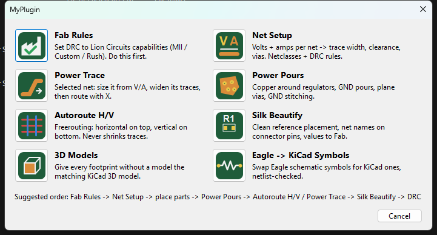
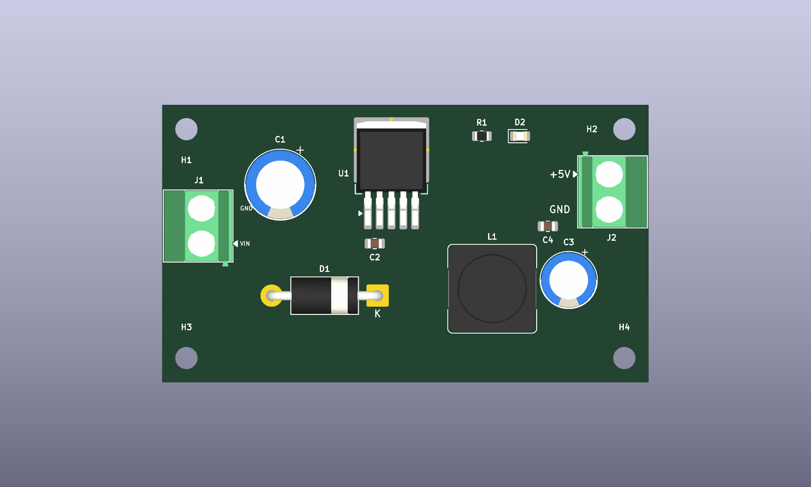

# MyPlugin for KiCad 10

One toolbar button, eight tools that take care of the tedious parts of PCB design: fab-correct DRC, trace widths from real current, power pours, a horizontal/vertical autorouter, clean silkscreen, and Eagle-import cleanup.



## Tools

| Tool | What it does |
|---|---|
| **Fab Rules** | Sets Board Setup constraints, the Default netclass and DRC rules to Lion Circuits' published capabilities (MII / Custom / Rush, 1–3 oz). Optionally makes them the default for every new project. |
| **Net Setup** | Enter voltage and current per net → IPC-2221 trace width, clearance, via size and via count. Creates netclasses, adds the sizes to the toolbar dropdowns, and writes `.kicad_dru` rules so DRC flags power traces that are too thin. |
| **Power Trace** | Select a pad or trace, enter V/A: the net gets its netclass, existing traces are widened, and the router switches to netclass width. |
| **Power Pours** | Copper around regulator pad groups, GND pours, plane vias for pads a pour would cut off, and a GND stitching grid. Skips pours that would create islands and says why. |
| **Autoroute H/V** | Freerouting with horizontal-on-top / vertical-on-bottom preference. Uses your netclasses, fanout and neck-down off: it never shrinks a trace to make it fit. |
| **Silk Beautify** | Places references cleanly, prints net names next to connector pins, moves values to Fab, lists anything it couldn't place. |
| **3D Models** | For footprints without a 3D model (typical after an Eagle import), finds the matching KiCad library footprint by pad geometry and attaches its model, aligned. |
| **Eagle → KiCad Symbols** | Replaces imported Eagle schematic symbols with KiCad library symbols, keeping the Eagle pin numbers so the PCB still matches. Nothing is saved unless the netlist is identical. |

Example: LM2596 buck converter placed with Fab Rules + Net Setup applied:



## Install

**From the release zip (recommended):** download `MyPlugin-<version>.zip` from [Releases](../../releases) → KiCad → *Plugin and Content Manager* → **Install from File…** → pick the zip → restart the PCB editor.

**Manual:** copy the `plugins/` folder to `<KiCad documents>/10.0/scripting/plugins/myplugin/` and restart KiCad.

Requirements: **KiCad 10.0** (SWIG Python API). Autoroute H/V additionally needs **Java 21+** and [`freerouting.jar`](https://github.com/freerouting/freerouting/releases) saved next to `autoroute_hv.py` (or set `FREEROUTING_JAR`).

## Suggested workflow

Fab Rules → Net Setup → place parts → Power Pours → Autoroute H/V / Power Trace → Silk Beautify → DRC.

## Extras in `docs/`

- **`KiCad-OneHand-Guide.pdf`**: printable guide: one-hand keyboard layout, MyPlugin workflow, design blocks how-to, Eagle ⇄ KiCad conversion.
- **`onehand.hotkeys`**: the keyboard layout itself (same key = same idea in schematic and PCB: `W` wire/route, `V` global label/via, `D` drag, `F` mirror/flip, `X` delete…). Import via *Preferences › Hotkeys › Import Hotkeys…*.

## Command line

Every tool also runs headless with KiCad's Python, e.g.

```
"C:\Program Files\KiCad\10.0\bin\python.exe" plugins\net_setup.py board.kicad_pcb --set "+12V=12:3" --set "GND=0:3"
"C:\Program Files\KiCad\10.0\bin\python.exe" plugins\fab_rules.py board.kicad_pcb --service MII --oz 1
"C:\Program Files\KiCad\10.0\bin\python.exe" plugins\eagle3d.py board.brd
```

Tests: `python tests/test_eagle3d.py` (3D model placement against KiCad's own footprints, all rotations).

## Notes & limits

- Net Setup widths use the IPC-2221 formula (slightly conservative vs IPC-2152); clearance from IPC-2221 table B2.
- Fab Rules numbers come from [Lion Circuits' capabilities page](https://lioncircuits.com/pcb-manufacturing-capabilities); check them against your order.
- Custom rules written by hand in `.kicad_dru` are not passed to Freerouting; netclass values are.
- There is no proper automatic KiCad → Eagle conversion; see the PDF for options.

## License

MIT © Atharva Tikle
